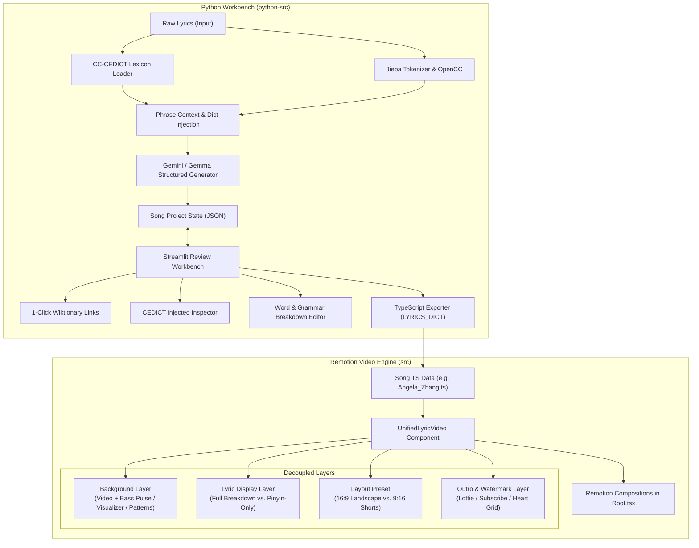
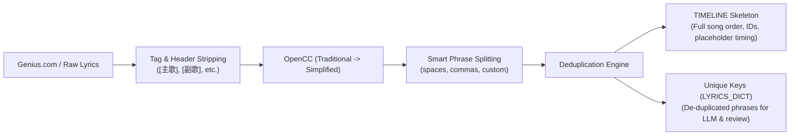

# Architectural Assessment & Phased Implementation Plan: Bilingual Lyric Engine & Review Workbench

## Goal Description
Build a streamlined, beginner-friendly pipeline for Mandarin Chinese bilingual (EN/PL) lyric video creation by solving two distinct bottlenecks:
1. **Python Translation & Review Workbench (`python-src`)**: Replace manual Wiktionary verification of LLM output with a lightweight, interactive web UI (Streamlit). It exposes injected CC-CEDICT definitions, provides 1-click Wiktionary links for every Hanzi token, allows editing/tweaking line translations and grammar breakdowns (including empty-Hanzi tokens like `"[if]"`), and exports clean TypeScript `LYRICS_DICT` objects.
2. **Remotion Video Engine Refactoring (`src`)**: Consolidate duplicated code across `LyricVideo`, `LyricVideo2`, `LyricVideoShort`, and `LyricVideoOnlyPinin` into a clean, modular component architecture decoupling **background layers** (video, audio visualizer, pattern grids), **aspect ratios** (16:9 landscape vs. 9:16 portrait shorts), and **lyric detail levels** (full vocabulary breakdown vs. Pinyin/Hanzi only).

---

## Architectural Breakdown



---

## 1. Python Translation & Review Workbench Architecture

### 1.1 Raw Lyrics Ingestion, Normalization & Deduplication Pipeline
Lyrics sourced from sites like Genius.com present several challenges:
1. Structural tags (`[主歌 1]`, `[副歌]`, `[前奏]`, song title headers).
2. Traditional Chinese characters (`人都應該有夢`).
3. Multi-phrase lines with whitespace (`人都應該有夢 有夢就別怕痛`) and parentheticals (`(與勇氣)`).
4. Extensive line repetitions across verses, choruses, and hooks.



#### Pipeline Steps:
1. **Header & Metadata Filtering**:
   - Detect and strip bracketed structural tags: `[前奏]`, `[主歌 1]`, `[導歌]`, `[副歌]`, `[間奏]`, `[尾奏]`, `[Chorus]`, `[Verse]`, etc.
   - Alternatively, allow keeping them as section dividers for visual navigation in the timeline.
2. **Traditional to Simplified Conversion**:
   - Convert all text via `OpenCC('t2s')` before tokenization and dictionary matching.
3. **Smart Phrase Splitting & Line Length Constraint (Max ~11 Characters)**:
   - **Why 11 Characters Max**: With 150px Hanzi, 42px Pinyin, 42px English gloss, and inter-word gaps on a 1920px canvas, lines exceeding 11 characters overflow horizontally or cause awkward wrapping (as seen in `Macchiato` where max length is 11, e.g. `心照不宣是我唯一的依赖`).
   - **Multi-delimiter Splitting**: Split compound lines on spaces, commas, or semicolons: e.g. `人都應該有夢 有夢就別怕痛` $\to$ `["人都应该有梦", "有梦就别怕痛"]`.
   - **Length Auditing & Natural Boundary Splitting**:
     * Automatically flag any line $> 11$ characters (e.g. `誰急速狂飆溅我一身的泥濘` = 12 chars).
     * Use `jieba` tokenization to suggest the most natural semantic split point (e.g., `谁急速狂飙` [5 chars] and `溅我一身的泥泞` [7 chars]).
     * In the Streamlit UI, display a badge `⚠️ 12 chars (> 11)` with a 1-click "Split at boundary" button, plus manual split point controls.
     * When split, automatically generate subline IDs for the timeline skeleton (e.g. `line-04` and `line-04a`).
4. **Deduplication & Dual-Output Mapping**:
   - **Song Timeline Order (`TIMELINE`)**:
     Preserves the complete flow of the song, generating sequential entries:
     ```typescript
     const TIMELINE = [
       { id: "line-00", startMs: 0, endMs: 0, lyricKey: "人都应该有梦" },
       { id: "line-01", startMs: 0, endMs: 0, lyricKey: "有梦就别怕痛" },
       // repeated lines reference the same lyricKey!
     ] as const;
     ```
   - **Unique Keys Set (`LYRICS_DICT`)**:
     Isolates only the unique phrases, tracking repetition counts (e.g. `"有梦就别怕痛" (appears 4x)`).
   - **Cost & Effort Optimization**:
     - The LLM translates each unique phrase **only once**.
     - The user verifies each unique phrase **only once** in the Streamlit UI.
     - All occurrences in the timeline automatically link to the verified dictionary entry!

### 1.2 Data Schema
The intermediate state and export structure follow the exact format required by the Remotion components:

```python
# Pydantic schema for robust validation and serialization
class WordBreakdown(BaseModel):
    hanzi: str               # e.g., "雨" or "" for grammar notes like "[if]"
    pinyin: str              # e.g., "yǔ" or ""
    translation_en: str      # e.g., "rain" or "to fear\nto be afraid" (supports \n or /)

class LineTranslation(BaseModel):
    en: str                  # e.g., "Rain splashes into my eyes, I can't see clearly."
    pl: str                  # e.g., "Deszcz pryska mi w oczy, widzę niewyraźnie."

class ReviewedLine(BaseModel):
    lyric_key: str           # Unique Chinese phrase, e.g. "有梦就别怕痛"
    simplified: str          # OpenCC converted simplified Chinese
    occurrences: int = 1     # How many times this phrase appears in the song
    cedict_injected: list[str] # All CC-CEDICT entries found for this phrase
    tokens: list[str]        # Jieba tokenized words + characters
    translation: LineTranslation
    words: list[WordBreakdown]
    verified: bool = False   # Checkbox for user review progress

class TimelineItem(BaseModel):
    id: str                  # e.g. "line-00", "line-01"
    start_ms: int = 0        # Placeholder for audio timing
    end_ms: int = 0          # Placeholder for audio timing
    lyric_key: str           # References ReviewedLine.lyric_key

class SongProject(BaseModel):
    title: str               # e.g., "淋雨一直走"
    artist: str              # e.g., "Angela Zhang"
    timeline: list[TimelineItem] # Full song timeline referencing lyric keys
    lyrics_dict: dict[str, ReviewedLine] # Unique keys only
```

### 1.3 Module Structure (`python-src/`)
```
python-src/
├── app.py                    # Streamlit entry point (Tabs: Raw Ingest -> Review -> Export)
├── core/
│   ├── parser.py             # Raw lyrics cleaning, header stripping & phrase splitter
│   ├── deduplicator.py       # Deduplication engine & TIMELINE skeleton generator
│   ├── cedict.py             # Efficient CC-CEDICT indexer & caching
│   ├── tokenizer.py          # OpenCC + Jieba token extraction
│   ├── llm_client.py         # Google GenAI client (Gemma/Gemini) with rate-limiting & retry
│   ├── storage.py            # Local JSON project save/load manager
│   └── exporter.py           # Formatter generating exact TypeScript TIMELINE + LYRICS_DICT code
├── requirements.txt          # streamlit, google-genai, jieba, opencc, python-dotenv, pydantic
└── data/                     # Saved song project JSONs for persistence
```

### 1.4 Key UI Features in Streamlit
1. **Raw Ingestion & Deduplication Tab**:
   - Paste raw lyrics from Genius.com or text files.
   - One-click "Clean & Deduplicate" with options to:
     * Strip section tags (`[主歌]`, etc.) or keep section breaks.
     * Split on multiple spaces/commas.
     * Convert Traditional to Simplified.
   - Shows summary statistics: e.g., "38 total lines reduced to 16 unique phrases (58% review time saved!)".
   - Shows an editable table of parsed phrases, character counts, and occurrence counts.
   - **Length Auditing**: Visually flags any line exceeding 11 characters (`⚠️ 12 chars (> 11)`) and suggests smart split points using Jieba token boundaries.
2. **CC-CEDICT Injected Definitions Panel**:
   - An expandable side-by-side view showing the exact definitions that were injected into the LLM context for each token.
3. **1-Click Wiktionary Verification**:
   - For every Chinese token and individual Hanzi, direct hyperlinks:
     `https://en.wiktionary.org/wiki/{quote(hanzi)}#Chinese`
   - Rendered as clickable pill-buttons above the editor row so the user can quickly check pronunciation, stroke orders, and nuanced definitions.
4. **Word & Grammar Breakdown Editor**:
   - Editable data editor table or dynamic form rows for each unique key.
   - Allows empty `hanzi` (for grammatical particles/contextual markers like `"[if]"`, `"Oh~"`).
   - "Add Word / Grammar Note" button, "Delete Token" button, and drag-and-drop or index shifting.
5. **Export Engine**:
   - Generates complete, valid TypeScript with both:
     * `const TIMELINE = [...] as const;` (with placeholder timestamps ready for Remotion timing).
     * `const LYRICS_DICT = {...} satisfies {...};` (with verified unique translations).
     * `export default { title, artist, get lines() { ... } };`
   - "Copy to Clipboard" and "Save to `src/<SongName>.ts`" buttons.

---

## 2. Remotion Video Engine Architecture

### 2.1 Current Duplication & Pain Points
| Feature | `LyricVideo` | `LyricVideo2` | `LyricVideoShort` | `LyricVideoOnlyPinin` |
|---|---|---|---|---|
| **Aspect Ratio** | 16:9 (1920x1080) | 16:9 (1920x1080) | 9:16 (1080x1920) | 16:9 (1920x1080) |
| **Background** | MP4 Video | MP4 + Bass Pulse + AudioVisualizer | MP4 Video (Offset) | MP4 Video |
| **Lyric Mode** | Full (Hanzi+Pinyin+En Word+Full) | Full | Full (Portrait Multi-row) | Pinyin-Only / Simplified |
| **Outro Layer** | Heart Grid + Lottie Outro | None | None | Heart Grid + Lottie Outro |
| **Styles / Fonts** | Copy-pasted fonts & text-shadow | Copy-pasted fonts & text-shadow | Copy-pasted fonts & text-shadow | Copy-pasted fonts & text-shadow |

### 2.2 Refactored Directory & Component Hierarchy (`src/`)
```
src/
├── types/
│   └── lyrics.ts             # LineData, SongData, LayoutPreset, LyricMode, BackgroundConfig
├── theme/
│   ├── fonts.ts              # Centralized NotoSansSC, Inter, LexendDeca font loaders
│   ├── shadows.ts            # heavyTextShadow helper functions
│   └── layoutPresets.ts      # Dimension constants, margins, font sizes for 16:9 vs 9:16
├── components/
│   ├── background/
│   │   ├── VideoBackground.tsx    # Video / OffthreadVideo with optional bass pulse / blur
│   │   ├── AudioVisualizer.tsx    # Mirrored top/bottom frequency bars
│   │   ├── HeartBackground.tsx    # Reusable heart pattern SVG grid
│   │   └── BackgroundRenderer.tsx # Discriminated union renderer for background configs
│   ├── lyrics/
│   │   ├── WordBlock.tsx          # Single token: Hanzi, Pinyin, En word translation
│   │   ├── SentenceRow.tsx        # Row/wrap layout of WordBlocks with responsive gaps
│   │   ├── FullTranslation.tsx    # Bilingual EN & PL sentence block
│   │   └── LyricLine.tsx          # Composes SentenceRow + FullTranslation
│   ├── overlays/
│   │   ├── Watermark.tsx          # Standard @SingInMandarin watermark
│   │   └── OutroSequence.tsx      # Configurable outro sequences with Lottie & heart pattern
│   └── UnifiedLyricVideo.tsx      # Top-level composition engine
└── Root.tsx                       # Clean composition definitions referencing UnifiedLyricVideo
```

### 2.3 Decoupled Props Design for `UnifiedLyricVideo`
```typescript
export interface UnifiedLyricVideoProps {
  song: SongData;
  layout?: 'horizontal' | 'vertical'; // Default: 'horizontal'
  mode?: 'full' | 'pinyin-only';      // Default: 'full'
  background: BackgroundConfig;
  outro?: OutroConfig;
  watermark?: string;                // Default: '@SingInMandarin'
  videoOffsetFrames?: number;        // e.g. -1074 for shorts
}

export type BackgroundConfig = 
  | { type: 'video'; src: string; bassPulse?: boolean }
  | { type: 'video-visualizer'; videoSrc: string; audioSrc: string; bassPulse?: boolean }
  | { type: 'visualizer'; audioSrc: string }
  | { type: 'image'; src: string }
  | { type: 'heart-pattern' };
```

### 2.4 Multi-Song File System Organization & Variations Management
Currently, songs and video files are flatly placed in `src/` (e.g. `Angela_Zhang_Keep_Walking.ts`, `LyricVideo.tsx`, `LyricVideo2.tsx`, `LyricVideoThumbnail.tsx`), requiring hardcoded imports and file duplication whenever a new song is added.

To support multiple songs with **all 3 video variations + thumbnails** cleanly, we organize the project as follows:

```
src/
├── songs/                                # Song repository
│   ├── angela-zhang-keep-walking/
│   │   ├── index.ts                      # Lyrics data (TIMELINE + LYRICS_DICT)
│   │   └── config.ts                     # Visual & timing config (MP4 file, fps, offsets, thumbnail assets)
│   ├── macchiato-special-affection/
│   │   ├── index.ts
│   │   └── config.ts
│   └── index.ts                          # Song Registry exporting all songs
```

#### The 3 Video Variations + Thumbnails Per Song:
Each song in the registry powers 5 distinct Remotion compositions:
1. **Full Lyric Video (16:9 Landscape - `1920x1080`)**:
   - Pinyin (top) + Chinese Hanzi (150px) + English word gloss + Full sentence EN & PL translations.
2. **Pinyin / Hanzi Only (16:9 Landscape - `1920x1080`)**:
   - Chinese Hanzi + Pinyin (stacked or swapped), no English gloss, no sentence translation.
3. **Shorts / Reels / TikTok (9:16 Portrait - `1080x1920`)**:
   - Optimized for mobile screens with wrapped words, tighter font scaling, and custom start frame offsets.
4. **Thumbnail - Full (Still `1280x720`)**:
   - Title words with Hanzi + Pinyin + English gloss, semi-transparent background image, and subtitle labels.
5. **Thumbnail - Pinyin Only (Still `1280x720`)**:
   - Title words with Hanzi + Pinyin ("characters with pinyin").

*(Note: Alternative thumbnails like `LyricVideoThumbnail2.tsx` with English title "Keep Walking" are supported via a `'minimal'` thumbnail variant).*

### 2.5 Unified Thumbnail Architecture (`src/components/thumbnails/UnifiedThumbnail.tsx`)
Replaces duplicated thumbnail files (`LyricVideoThumbnail.tsx`, `LyricVideoThumbnail2.tsx`, `LyricVideoThumbnailOnlyPinyin.tsx`) with a single configurable component:
```typescript
export interface UnifiedThumbnailProps {
  titleWords: WordData[];
  variant?: 'full' | 'pinyin-only' | 'minimal';
  bgImage: string;            // e.g. "thumbnail-bg-369.png"
  emojiBackground?: string;   // e.g. "♪♬" or "♪♪♪♪"
  topLabel?: string;          // Default: "Mandarin song lyrics"
  bottomLabel?: string;       // Default: "Pinyin · English · Polish"
  englishTitle?: string;      // e.g. "Keep Walking" (for minimal variant)
}
```

#### Automated Composition Registration in `src/Root.tsx`:
Remotion's `<Folder>` component neatly groups compositions per song in the Remotion Studio sidebar:
```tsx
export const RemotionRoot: React.FC = () => {
  return (
    <>
      {SONGS.map((song) => (
        <Folder name={song.title} key={song.id}>
          <Composition id={`${song.id}-full`} component={UnifiedLyricVideo} defaultProps={{ song, mode: 'full', layout: 'horizontal' }} ... />
          <Composition id={`${song.id}-pinyin`} component={UnifiedLyricVideo} defaultProps={{ song, mode: 'pinyin-only', layout: 'horizontal' }} ... />
          <Composition id={`${song.id}-short`} component={UnifiedLyricVideo} defaultProps={{ song, mode: 'full', layout: 'vertical' }} ... />
          <Still id={`${song.id}-thumb-full`} component={UnifiedThumbnail} defaultProps={{ ... }} ... />
          <Still id={`${song.id}-thumb-pinyin`} component={UnifiedThumbnail} defaultProps={{ ... }} ... />
        </Folder>
      ))}

      {/* Legacy Aliases for 100% Backwards Compatibility */}
      <Composition id="LyricVideo" component={LyricVideo} ... />
      <Composition id="LyricVideo2" component={LyricVideo2} ... />
      <Composition id="LyricVideoShort" component={LyricVideoShort} ... />
      <Composition id="LyricVideoOnlyPinin" component={LyricVideoOnlyPinin} ... />
      <Still id="Thumbnail" component={LyricVideoThumbnail} ... />
      <Still id="Thumbnail2" component={LyricVideoThumbnail2} ... />
      <Still id="ThumbnailOnlyPinyin" component={LyricVideoThumbnailOnlyPinyin} ... />
    </>
  );
};
```

---

## User Review Required

> [!IMPORTANT]
> **Streamlit Dependencies**: We will need to install `streamlit` into `python-src/venv`. It runs locally via `streamlit run python-src/app.py`.
> 
> **Backwards Compatibility**: All existing compositions in `Root.tsx` (`LyricVideo`, `LyricVideo2`, `LyricVideoShort`, `LyricVideoOnlyPinin`, and thumbnails) will be preserved with identical frame rates, dimensions, and visual fidelity so that existing render pipelines continue to work without breaking changes.

---

## Phased Milestone Roadmap

To ensure changes are reliable, testable, and do not exceed context token limits during execution, the work is split into 6 phased milestones:

### Milestone 1: TypeScript Design System & Theme Centralization
- **Objective**: Eliminate repeated font definitions, CSS styles, and shadow functions across `src/`.
- **Files**:
  - `[NEW] src/types/lyrics.ts`: Standardize `WordData`, `LyricLineData`, `SongData`, `LayoutPreset`, `LyricMode`, `BackgroundConfig`.
  - `[NEW] src/theme/fonts.ts`: Single point of instantiation for `NotoSansSC`, `Inter`, `LexendDeca`.
  - `[NEW] src/theme/shadows.ts`: Reusable `heavyTextShadow` and `heavyTextShadow2`.
  - `[NEW] src/theme/styles.ts`: Style token mappings for horizontal vs. vertical layouts.
- **Verification**: `npm run lint` passes and types are verified.

### Milestone 2: Remotion Atomic Components (Backgrounds, Lyrics & Thumbnails)
- **Objective**: Break monolithic video and thumbnail files into composable, isolated components.
- **Files**:
  - `[NEW] src/components/background/VideoBackground.tsx` (supports standard video or bass-pulse scale/blur).
  - `[NEW] src/components/background/AudioVisualizer.tsx` (decoupled from `LyricVideo2`).
  - `[NEW] src/components/background/HeartBackground.tsx` (reusable pattern).
  - `[NEW] src/components/lyrics/WordBlock.tsx` (supports full vs. `onlyPinyin` display).
  - `[NEW] src/components/lyrics/LyricLine.tsx` (handles 16:9 vs 9:16 layout differences).
  - `[NEW] src/components/thumbnails/UnifiedThumbnail.tsx` (unifies `Thumbnail`, `Thumbnail2`, and `ThumbnailOnlyPinyin`).
  - `[NEW] src/components/overlays/Watermark.tsx` and `OutroSequence.tsx`.
- **Verification**: Render isolated components and check for zero regressions.

### Milestone 3: Unified Video Engine, Song Registry & Composition Migration
- **Objective**: Create `UnifiedLyricVideo.tsx`, organize songs into `src/songs/`, and refactor `src/Root.tsx`.
- **Files**:
  - `[NEW] src/components/UnifiedLyricVideo.tsx`.
  - `[NEW] src/songs/angela-zhang-keep-walking/index.ts` & `config.ts`.
  - `[NEW] src/songs/macchiato-special-affection/index.ts` & `config.ts`.
  - `[NEW] src/songs/index.ts` (Registry exporting all songs).
  - `[MODIFY] src/Root.tsx`: Group compositions cleanly using Remotion `<Folder>` for each song (registering Full, Pinyin-Only, Short, and Thumbnails) while retaining legacy aliases for 100% backwards compatibility.
  - Archive or deprecate the legacy monolithic files.
- **Verification**: Run `npm run dev` and visually verify all compositions and thumbnails in Remotion Studio match existing behavior pixel-for-pixel.

### Milestone 4: Python Translation Engine, Parsing & Lexicon Layer
- **Objective**: Modularize `python-src/translate.py` into a robust backend library with raw lyrics parsing and deduplication.
- **Files**:
  - `[NEW] python-src/requirements.txt`: Add `streamlit`, `pydantic`.
  - `[NEW] python-src/core/parser.py`: Raw lyrics tag filtering (`[主歌]`, etc.), Traditional-to-Simplified OpenCC conversion, and smart line/phrase splitting.
  - `[NEW] python-src/core/deduplicator.py`: Timeline sequential mapping vs. unique keys deduplication engine.
  - `[NEW] python-src/core/cedict.py`: Fast dictionary lookup & caching.
  - `[NEW] python-src/core/tokenizer.py`: OpenCC + Jieba token and character extractor.
  - `[NEW] python-src/core/llm_client.py`: Google GenAI wrapper with structured outputs, retries, and rate limit handling.
  - `[NEW] python-src/core/storage.py`: Song project JSON save/load manager.
  - `[NEW] python-src/core/exporter.py`: Code generator outputting formatted TypeScript (`TIMELINE` skeleton + `LYRICS_DICT`).
- **Verification**: Run test script validating raw lyrics ingestion, deduplication into `TIMELINE` + `LYRICS_DICT`, and dictionary lookup.

### Milestone 5: Streamlit Interactive Review Workbench UI
- **Objective**: Build the user-friendly UI for raw ingestion, deduplication, translation, and verification against Wiktionary.
- **Files**:
  - `[NEW] python-src/app.py`:
    * **Tab 1: Raw Ingest & Deduplication**: Paste Genius.com lyrics, auto-strip tags, split phrases, view deduplication metrics (e.g. 38 lines -> 16 unique keys).
    * **Tab 2: Translation & Review**: View injected CC-CEDICT definitions, 1-click Wiktionary link buttons (`en.wiktionary.org/wiki/<hanzi>`), editable word & grammar breakdown form.
    * **Tab 3: Export & Timeline**: Preview and export clean TypeScript code with `TIMELINE` skeleton + `LYRICS_DICT`.
- **Verification**: Launch `streamlit run python-src/app.py`, paste raw Genius lyrics, verify deduplication, Wiktionary links, and TS export.

### Milestone 6: End-to-End Workflow Integration & Documentation
- **Objective**: Connect the Python workbench export directly with Remotion compositions.
- **Files**:
  - `[NEW] docs/WORKFLOW.md`: Guide for importing a new song, translating via UI, exporting TS, and rendering Remotion video.
  - Test the entire pipeline on a sample 3-phrase lyric song from raw text to rendered video.
- **Verification**: Complete sample workflow run from raw Chinese lyric input to exported TS and Remotion preview.

---

## Verification Plan

### Automated Checks
- **TypeScript & Lint**: `npm run lint` (`eslint src && tsc`) to ensure zero type errors or lint warnings.
- **Python Imports & Typing**: Verify Python backend scripts run with `python -m py_compile` and unit tests in `python-src/tests`.

### Manual & Visual Verification
1. **Remotion Studio**: Launch `npm run dev`, inspect each composition (`LyricVideo`, `LyricVideo2`, `LyricVideoShort`, `LyricVideoOnlyPinin`) and verify identical text placement, animations, and visualizer rendering.
2. **Streamlit UI**: Run `streamlit run python-src/app.py`, test the 1-click Wiktionary links, edit line translations and word breakdowns, and export to a `.ts` file. Verify the exported file compiles without TypeScript errors.
