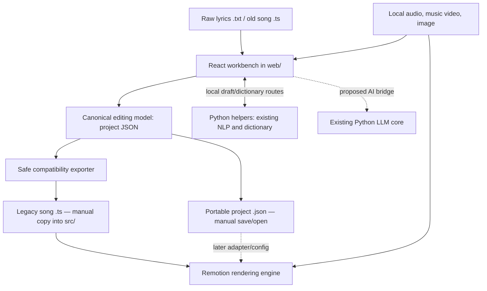

# Architecture and data contracts

## Components and boundaries

Use a lightweight React + TypeScript app in `web/`, preserving existing Remotion scripts. Prefer existing dependencies; inspect before choosing a dev server or AST parser. If a Python API is genuinely useful, expose the existing core from `python-src/`; a minimal FastAPI layer is an _option_, not a prerequisite.

## Four different dimensions of the data

1. **Phrase** — unique text and linguistic annotation, reviewed once; a repeated chorus shares translation/glosses.
2. **Occurrence** — one ordered usage of a phrase, with its **own** `startMs` / `endMs` and stable ID; a chorus can repeat at different timestamps.
3. **Media** — audio playback is required to synchronize and check occurrence timestamps. Currently the user selects an audio/video file in Timing. The location and method of choosing that source may change; the playback requirement remains. Use one master audio source to avoid playing two soundtracks. Image/background media serves the separate rendering workflow.
4. **Visual settings** — presets and overrides for the video background, visualizer, typography, aspect ratio, overlays and thumbnails. Do not entangle this with the phrase dictionary.

## Implemented schemas and persistence

The source contracts are [React domain schemas](../../web/src/domain.ts), [legacy importer/exporter](../../web/src/legacy.ts), and [Python models](../../python-src/workbench/models.py). Do not copy an illustrative model into application code.

React project JSON uses `format: "lyric-workbench"`, `schemaVersion: 1`, metadata, phrases, occurrences and source. Phrases have stable token IDs, a `pending`/`reviewed` state and `segmentationApproved`; occurrences reference phrase IDs and allow null timing. Optional timing baselines, lightweight audio metadata and fixed-membership lyric groups persist. Local media bytes/object URLs, dictionary results and view layout do not persist. Old phrase notes/dictionary fields are discarded on load. Visual configuration and video/image media references are not implemented schema fields.

Python projects use `version: 1`, phrase text, separate vocabulary/translation states and provenance, plus a timeline keyed by lyric text with non-null zero placeholders. They have no token IDs. They are not interchangeable with React JSON; C needs explicit adapters that preserve identities, authored edits and timing.

Browser files use session-local File/Blob object URLs and require relinking after reload. Remotion currently resolves named assets with `staticFile` from `public/`; project downloads do not bundle those assets. Asset persistence, preview resolution and a possible local asset service remain future work, not guarantees that arbitrary filesystem paths will resolve.

The [approved Timing review plan](features/automatic-timing-review/SPEC.md#14-completion-plan--documentation-commit-before-implementation)
adds independent occurrence review, automatic/reviewed snapshots, pending detected
and weak candidates, source-audio hashes and portable preferences. These are not
implemented yet. Keep `schemaVersion: 1` without a new version bump: absence of the
new review metadata triggers legacy migration, while explicit new Needs review
metadata must survive saves. Valid legacy current times become reviewed snapshots;
retire old `timingBaseline` as a competing reset target. Older strict builds may
reject added fields despite the unchanged marker; legacy TS stays unchanged. Save
minimal candidate/run context and normalized-audio identity, not media bytes or
full transcripts. Matching hashes permit candidate reuse; mismatches require an
explicit choice, and unknown identity is not claimed as matching.

## Word segmentation and Pinyin invariant

[WORD_SEGMENTATION.md](WORD_SEGMENTATION.md) is authoritative for word segmentation, Pinyin spelling/tones, preservation rules and implementation/test references. `Phrase.words` is an ordered, editable segmentation shared by all occurrences of that phrase.

## One song, two interoperable artifacts

- **Legacy `.ts` export:** preserve the existing `TIMELINE` and `LYRICS_DICT` structure and `get lines()` default song object; include timed occurrence IDs, order, `lyricKey`, EN/PL and word glosses. Omit workbench-only state that current consumer types do not understand.
- **Project JSON:** canonical editing state holding stable IDs, review metadata, optional unsynchronized/null timings, lightweight audio metadata, groups and schema version. Visual presets and richer media references remain proposed. This is a distinct artifact and must not be mistaken for legacy song data. Make it versioned and validate it. The app should warn if exporting a `.ts` before all timings are set.

Versioned JSON is important for a local editor: TypeScript may be used for the first import but shouldn't become a hardcoded UI storage format indefinitely. Design an adapter to read/export old songs; do not force changes on the existing song files during the first milestone.

## Safe old TypeScript import

The committed example uses const arrays, spreads, static object literals, non-ASCII property names, `as const`, references between declarations, and a known getter pattern. **Never run an imported `.ts` as code** (`eval`, `Function`, dynamic import, Node subprocess execution). Use an allowlisted, non-executing AST interpreter against known shapes, with cycle detection and actionable diagnostics. Reject unsupported executable expressions rather than guessing. Preserve previous editor state when import fails. Compare semantic normalized round-trips, not source formatting.

## Time representation

- UI/API **integer milliseconds**, inclusive-exclusive intervals `[startMs, endMs)`; `endMs > startMs` for assigned intervals. Treat original imported timing convention as authoritative until verified; do not change renderer behavior silently.
- Audio playback clock in seconds; convert at the UI boundary (`ms = round(currentTime * 1000)`). `requestAnimationFrame` updates the visual playhead, but **audio.currentTime is the source of truth**.
- Remotion render clock uses frames. Convert at the renderer boundary with the verified FPS/rounding convention, and compare known frames against baseline. Do not snap every authored millisecond to frames in the editor unless explicitly requested.
- Preserve deliberate lyric gaps and permitted overlaps; warn rather than auto-correct. Repeat occurrences have independent timing.
- Add **global offset only if confirmed existing behavior or explicit user setting**; do not bake offsets into every occurrence on export by default.

## Configuration policy

Three levels, in precedence order: **built-in safe defaults < named video preset < per-song overrides**. Composition-level props can override the resolved config for Studio experiments where appropriate. Resist a flat component with dozens of unrelated optional props: prefer discriminated background variants, typed grouped options, and small reusable subcomponents. Different video modes should share common lyric drawing, not automatically share all background implementation.

## Implemented local Python integration

[web/dev.ts](../../web/dev.ts) serves loopback-only React tooling and delegates two POST routes through [import-api.ts](../../web/import-api.ts):

- `/api/import-lyrics` invokes `workbench.react_ingest` for OpenCC/Jieba/CC-CEDICT word drafts; sentence EN/PL translations remain manual.
- `/api/dictionary` invokes `workbench.react_dictionary` on demand. Results are memory-cached in React, attributed to CC-CEDICT/MDBG and excluded from saved songs/projects.

These bounded subprocess routes reject cross-origin browser requests, preserve the open project on failure and do not perform AI generation. A standalone static bundle does not supply these development-server routes. Keep dictionary senses distinct from future model-inferred contextual meanings; never claim a sense match without identifying one.

Automatic timing is planned separately in [Automatic Timing & Review](features/automatic-timing-review/SPEC.md).
Its Python worker and local API are not part of the committed baseline; the
implemented routes above cover raw lyric drafts and dictionary lookup only.

## Proposed AI interface and backend reuse

Reuse UI-independent `python-src/workbench/` models/storage, songs, generation, generation_plan, prompts, pinyin, vocabulary, responses and transport modules. Preserve retries, validation and checkpointing; do not recreate the core or remove Streamlit until migration is verified. A minimal HTTP framework is an option, not an approved dependency or prerequisite for existing routes.

The following routes are proposals, not implemented APIs:

- `POST /api/lyrics/normalize` — normalization and segmentation suggestions.
- `POST /api/translation/generate` — per-unique-phrase AI draft with prompt/model metadata.
- `POST /api/translation/revise` — selected phrase/token only, with user instructions.
- `GET /api/dictionary?term=...` — CC-CEDICT and provenance.

Generate/revise per unique phrase, reusing results across occurrences. Show dictionary evidence and store provider/model/prompt provenance. Acceptance or replacement must be explicit and undoable, retain occurrence timing and phrase IDs, and preserve manual changes on failure/cancellation/retry. Apply the [segmentation contract](WORD_SEGMENTATION.md) to backend output and proposal acceptance. C is complete when a draft can be generated, corrected, saved and exported without losing those protections.

Never send credentials to React. Keep generated suggestions separate from accepted edits, support cancellation, retries and invalidation. Manual browser timing and compatible local file import/export do not require a provider backend; raw dictionary import uses local Python routes, and planned automatic timing will require its own local route. Any paid API call must be deliberate, especially while developing.

## Preservation and deferred scope

Keep published song modules, media, original Remotion entrypoints/IDs and manual TS placement working. Existing imports include shared arrays/spreads, unused dictionary entries, parenthetical tokens, multiline glosses and empty-Hanzi notes; retain their semantics. Authored reading preservation follows the [segmentation contract](WORD_SEGMENTATION.md).

Automatic repository writes/registration, hosting/multiuser operation, multitrack mixing and effect keyframes are deferred. Production composition usage and the shared preview/config/asset adapter must be established during D/E; file editing does not depend on resolving those questions. Priorities belong to [ROADMAP](../ROADMAP.md).
