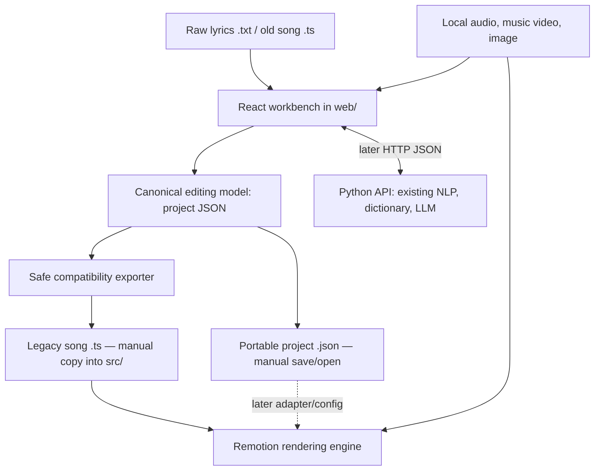

# Architecture and data contracts

## Components and boundaries



Use a lightweight React + TypeScript app in `web/`, preserving existing Remotion scripts. Prefer existing dependencies; inspect before choosing a dev server or AST parser. If a Python API is genuinely useful, expose the existing core from `python-src/`; a minimal FastAPI layer is an *option*, not a prerequisite.

## Four different dimensions of the data

1. **Phrase** — unique text and linguistic annotation, reviewed once; a repeated chorus shares translation/glosses.
2. **Occurrence** — one ordered usage of a phrase, with its **own** `startMs` / `endMs` and stable ID; a chorus can repeat at different timestamps.
3. **Media** — optional local audio/video/image references and synchronization information; choose one master audio source (do not inadvertently double audio by playing video sound and an audio file).
4. **Visual settings** — presets and overrides for the video background, visualizer, typography, aspect ratio, overlays and thumbnails. Do not entangle this with the phrase dictionary.

A proposed internal model (Codex must reconcile with existing types):

```ts
type Phrase = {
  id: string; // internal stable identity (not derived from mutable text)
  lyricKey: string;
  translation: { en: string; pl: string };
  words: Array<{
    id: string;
    hanzi: string;      // empty for contextual notes
    pinyin: string;
    translation: { en: string }; // supports newlines
  }>;
  review: { status: 'pending' | 'reviewed'; updatedAt?: string };
};

type Occurrence = {
  id: string;
  phraseId: string;
  startMs: number | null; // null = unassigned; never fabricate accurate times
  endMs: number | null;
};

type MediaSource =
  | { kind: 'audio'; path?: string; name?: string }
  | { kind: 'video'; path?: string; name?: string; audioRole: 'master' | 'muted' }
  | { kind: 'image'; path?: string; name?: string };

type BackgroundConfig =
  | { kind: 'music-video'; videoRef: string; fit: 'cover' | 'contain'; blur?: number; dim?: number }
  | { kind: 'image-visualizer'; imageRef: string; visualizer: VisualizerConfig; motion?: 'none' | 'slow-zoom' };

type VisualizerConfig = {
  enabled: boolean;
  style: 'bars' | 'waveform';
  primaryColor: string;
  secondaryColor?: string;
  opacity: number;
  intensity: number;
};

type VisualConfig = {
  presetId: string;
  background: BackgroundConfig;
  aspectRatio: '16:9' | '9:16';
  lyrics: { showPinyin: boolean; showEnglish: boolean; showPolish: boolean; scale: number };
  watermark?: { enabled: boolean; text?: string };
};

type SongProject = {
  schemaVersion: 1;
  song: { title: string; artist: string };
  phrases: Phrase[];
  occurrences: Occurrence[];
  media: { audio?: MediaSource; video?: MediaSource; image?: MediaSource };
  visuals?: VisualConfig;
  source?: { filename?: string; importedFormat?: 'raw' | 'legacy-ts' };
};
```

Types are **illustrative**, not an instruction to copy them verbatim. Type-check against actual Remotion consumers. `MediaSource.path` is an *asset reference*, not a promise that arbitrary paths are available inside the browser or Remotion bundle. For browser-imported files use `File` / `Blob` object URLs during the session; handle reload/reselect explicitly. Remotion assets should eventually resolve from the actual project's `public/` paths or an intentional local asset service.

## Word segmentation and Pinyin invariant

See **`WORD_SEGMENTATION.md`** for required merge/split UX, domain operations and tests. `Phrase.words` is an **ordered, editable segmentation**, not immutable LLM output. Merge or split inside one phrase; preserve phrase-level translations and all occurrence timing. An actual word's `pinyin` value uses a contiguous spelling (`piàoliang`), whereas Pinyin across **different** word tokens is displayed with spaces (`wǒ xǐhuan`). Empty-Hanzi grammar annotations are not lexical tokens and may have empty Pinyin. AI backend prompts, response validation, import/export adapters and the editor must all enforce this distinction. Do not silently re-segment user-reviewed words or rewrite hand-edited imports.

## One song, two interoperable artifacts

- **Legacy `.ts` export:** preserve the existing `TIMELINE` and `LYRICS_DICT` structure and `get lines()` default song object; include timed occurrence IDs, order, `lyricKey`, EN/PL and word glosses. Omit workbench-only state that current consumer types do not understand.
- **Project JSON:** canonical editing state holding stable IDs, review metadata, media references, visual presets, optional unsynchronized/null timings, and version. This is a distinct artifact and must not be mistaken for legacy song data. Make it versioned and validate it. The app should warn if exporting a `.ts` before all timings are set.

Versioned JSON is important for a local editor: TypeScript may be used for the first import but shouldn't become a hardcoded UI storage format indefinitely. Design an adapter to read/export old songs; do not force changes on the existing song files during the first milestone.

## Safe old TypeScript import

The committed example uses const arrays, spreads, static object literals, non-ASCII property names, `as const`, references between declarations, and a known getter pattern. **Never run an imported `.ts` as code** (`eval`, `Function`, dynamic import, Node subprocess execution). Use an allowlisted, non-executing AST interpreter against known shapes, with cycle detection and actionable diagnostics. Reject unsupported executable expressions rather than guessing. Preserve previous editor state when import fails. Compare semantic normalized round-trips, not source formatting.

## Time representation

- UI/API **integer milliseconds**, inclusive-exclusive intervals `[startMs, endMs)`; `endMs > startMs` for assigned intervals. Treat original imported timing convention as authoritative until verified; do not change renderer behavior silently.
- Audio playback clock in seconds; convert at the UI boundary (`ms = round(currentTime * 1000)`). `requestAnimationFrame` updates the visual playhead, but **audio.currentTime is the source of truth**.
- Remotion render clock uses frames. Convert at the renderer boundary with the verified FPS/rounding convention, and compare known frames against baseline. Do not snap every authored millisecond to frames in the editor unless explicitly requested.
- Preserve deliberate lyric gaps and permitted overlaps; warn rather than auto-correct. Repeat occurrences have independent timing.
- Add **global offset only if confirmed existing behavior or explicit user setting**; do not bake offsets into every occurrence on export by default.

## Configuration policy

Three levels, in precedence order: **built-in safe defaults < named video preset < per-song overrides**. Composition-level props can override the resolved config for Studio experiments where appropriate. Resist a flat component with dozens of unrelated optional props: prefer discriminated background variants, typed grouped options, and small reusable subcomponents. Different video modes should share common lyric drawing, not automatically share all background implementation.

## Interface to Python (phase after file MVP / timing)

Suggested endpoints (adapt to actual code):

- `POST /api/lyrics/normalize` — normalization and segmentation suggestions.
- `POST /api/translation/generate` — per-unique-phrase AI draft with prompt/model metadata.
- `POST /api/translation/revise` — selected phrase/token only, with user instructions.
- `GET /api/dictionary?term=...` — CC-CEDICT and provenance.

Never send credentials to React. Keep generated suggestions separate from accepted edits, support cancellation, retries and invalidation. Backend not required for audio timing or safe local file import/export. Any paid API call must be deliberate, especially while developing.
